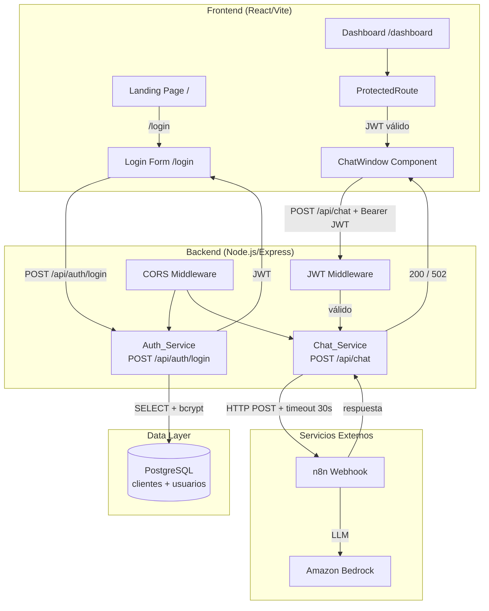

# Design Document — Sistema Web Telecom FyB

> **⚠️ DOCUMENTO HISTÓRICO — V1 (ver notas `> V2:` inline en cada sección afectada).** Este documento describe la arquitectura ya implementada y testeada de Telecom FyB V1. El Proyecto Fénix V2 revirtió varias decisiones clave (persistencia de chat, esquema de DB, alcance del sistema). La fuente de verdad actual está en el vault de Obsidian: `Elias/01 - Proyectos/Telecom/Proyecto Fénix V2 - Arquitectura.md` y `Proyecto Fénix V2 - Chat y Tickets.md`. No uses este documento como fuente de verdad para el chat, la persistencia o el esquema de DB sin cruzarlo primero con el vault.

## Overview

El sistema es una aplicación web corporativa modular para **Telecom FyB**, compuesta por tres capas principales:

1. **Frontend SPA** (React + Vite + Tailwind CSS) — Landing Page, Login y Dashboard con Chat.
2. **Backend API** (Node.js + Express) — Auth_Service, Chat_Service y middleware de JWT.
3. **Base de datos** (PostgreSQL) — Tablas `clientes` y `usuarios` con relación FK.

El flujo principal es: un visitante llega a la Landing Page → inicia sesión (el Auth_Service valida credenciales y churn) → accede al Dashboard → usa el ChatWindow para enviar consultas que el Chat_Service reenvía al webhook de n8n (Amazon Bedrock) → recibe respuestas de IA en tiempo real.

La arquitectura es deliberadamente sencilla: sin microservicios, sin colas de mensajes. *(V1: tampoco había persistencia de chat — **V2 revirtió esto**: el chat ahora persiste en tiempo real en `historial_mensajes` y se sube crudo a S3, como insumo del modelo de Churn. Ver `Proyecto Fénix V2 - Chat y Tickets.md` en el vault.)*

---

## Architecture



### Decisiones de diseño clave

| Decisión | Alternativa descartada | Justificación |
|---|---|---|
| JWT stateless en sessionStorage | Cookies httpOnly / Redis sessions | Simplicidad; sessionStorage es automáticamente purgado al cerrar pestaña |
| Pool pg (node-postgres) | Prisma / TypeORM | Sin overhead de ORM; el esquema ya existe y es fijo |
| n8n como orquestador de IA | Llamada directa a Bedrock | Desacoplamiento; el backend no necesita credenciales AWS; n8n es reemplazable |
| ~~Sin persistencia de chat~~ → **V2: SE PERSISTE** | Guardar mensajes en DB | *(V1)* Requisito explícito de privacidad (8.1, 8.4). **V2: decisión revertida** — todos los mensajes se guardan en tiempo real en `historial_mensajes` y se suben crudos a S3 como insumo para reentrenar el modelo de Churn. Ver `Proyecto Fénix V2 - Chat y Tickets.md`. |
| Churn check ANTES de bcrypt | Después | Evita CPU innecesaria en cuentas inactivas; más rápido |

---

## Components and Interfaces

### Backend

#### `index.js` — Punto de entrada del servidor

Responsabilidades:
- Cargar `.env` como primera instrucción (`dotenv.config()`).
- Validar presencia de variables de entorno requeridas; abortar con `process.exit(1)` si alguna falta.
- Crear e inicializar el Pool de PostgreSQL; abortar si la conexión falla.
- Registrar middlewares: CORS (orígenes desde `CORS_ALLOWED_ORIGINS`), `express.json` (límite 1 MB).
- Montar rutas: `authRouter` en `/api/auth`, `chatRouter` en `/api/chat`.
- Iniciar el servidor HTTP en el puerto definido por `PORT` (default 3001).

Variables de entorno requeridas: `DB_HOST`, `DB_PORT`, `DB_NAME`, `DB_USER`, `DB_PASSWORD`, `JWT_SECRET`, `N8N_WEBHOOK_URL`, `CORS_ALLOWED_ORIGINS`.

#### `auth.routes.js` + `auth.controller.js` — Auth_Service

**Endpoint:** `POST /api/auth/login`

Flujo de validación (orden estricto):
1. Validar presencia y formato de `email` y `password` (no vacíos, longitud ≤ 254 / ≤ 128). → HTTP 400 si falla.
2. Buscar usuario por email con JOIN a `clientes`. → HTTP 401 si no existe.
3. Verificar `clientes.churn !== 1`. → HTTP 403 si es churn.
4. Comparar `bcrypt.compare(password, usuario.password_hash)`. → HTTP 401 si no coincide.
5. Firmar y retornar JWT con `{ userId, email, exp: now+24h }`. → HTTP 200.

```typescript
// Interfaz de respuesta exitosa
interface LoginResponse {
  token: string;  // JWT firmado
}

// Interfaz de error
interface ErrorResponse {
  message: string;
}
```

#### `chat.routes.js` + `chat.controller.js` — Chat_Service

**Endpoint:** `POST /api/chat` (requiere `Authorization: Bearer <JWT>`)

Flujo:
1. JWT Middleware verifica token (ver sección siguiente). → HTTP 401 si inválido.
2. Extraer `message` del body. Validar no vacío y ≤ 2000 chars. → HTTP 400 si falla.
3. `axios.post(N8N_WEBHOOK_URL, { customer_id, message }, { timeout: 30_000 })`. (Nota: el payload real incluye `customer_id` tomado de `req.user`, además de `message`.)
4. Si respuesta 200 y body no vacío → retornar body al frontend con HTTP 200.
5. Si timeout / non-200 / body vacío → retornar HTTP 502 con causa específica.

```typescript
interface ChatRequest {
  message: string;  // 1–2000 caracteres
}

interface ChatResponse {
  reply: string;    // respuesta de n8n/Bedrock
}
```

#### `middleware/auth.js` — JWT Middleware

- Extrae el header `Authorization: Bearer <token>`.
- Verifica con `jwt.verify(token, JWT_SECRET)`.
- Adjunta el payload decodificado a `req.user`.
- Retorna HTTP 401 con causa específica: `"Token ausente"`, `"Token inválido"`, `"Token expirado"`.

### Frontend

#### Estructura de rutas (React Router)

```
/             → <LandingPage />         (pública; redirect a /dashboard si JWT válido)
/login        → <LoginPage />           (pública; redirect a /dashboard si JWT válido)
/dashboard    → <ProtectedRoute>        (privada; redirect a /login si sin JWT)
                  <DashboardPage />
                    <ChatWindow />
```

#### `ProtectedRoute.jsx`

- Lee JWT de `sessionStorage`.
- Decodifica payload con `jwt-decode` (sin verificación de firma; la validación real la hace el backend).
- Si ausente o expirado: elimina JWT de sessionStorage y hace `<Navigate to="/login" />`.
- Si válido: renderiza `children`.

#### `LoginPage.jsx` / `useAuth.js`

- Formulario controlado con estado React.
- Validación client-side: campos no vacíos antes de enviar.
- Timeout de fetch: 10 segundos con `AbortController`.
- Almacena JWT en `sessionStorage.setItem('token', jwt)` al recibir HTTP 200.
- Muestra mensajes diferenciados por código HTTP (400, 401, 403, timeout).

#### `ChatWindow.jsx` / `useChatHistory.js` — **⚠️ V2: reemplazado por `ChatWidget` con persistencia real, ver vault**

- *(V1)* Historial de mensajes en `useState`: array de `{ role: 'user'|'assistant', content: string, id: string }`. **V2: cada mensaje se persiste en tiempo real en `historial_mensajes` vía `POST /api/chat/message`; `useState` deja de ser la única fuente de verdad.**
- Al desmontar (`useEffect` cleanup): cancela petición en vuelo con `AbortController.abort()` — *esto sigue vigente en V2*.
- Lógica de envío:
  1. Validar longitud ≤ 2000 chars (bloquear si excede).
  2. Agregar mensaje al historial con latencia ≤ 100 ms.
  3. Deshabilitar input; mostrar indicador de carga animado (CSS Tailwind `animate-pulse` o `animate-bounce`).
  4. `fetch('/api/chat', { headers: { Authorization: 'Bearer '+token }, body: JSON.stringify({message}), signal })`.
  5. Si OK: ocultar indicador, agregar respuesta, rehabilitar input.
  6. Si error: mostrar mensaje de fallo con causa, rehabilitar input.

---

## Data Models

### Tabla `clientes` (existente — solo lectura desde la app)

| Campo | Tipo | Notas |
|---|---|---|
| `customer_id` | `INT` | PK, autoincremental |
| `churn_historico` | `BOOLEAN` | `true` = dado de baja, `false` = activo. **Nota:** el nombre real de columna en la DB de producción es `churn_historico` (booleano), no `churn` (INT) como se planteó originalmente en este documento. El Auth_Service lo mapea con alias SQL (`c.churn_historico as churn`) y lo compara con `=== true`. |
| … | … | Otros campos del negocio |

### Tabla `usuarios` (nueva — creada por migración)

```sql
CREATE TABLE IF NOT EXISTS usuarios (
    id             SERIAL PRIMARY KEY,
    customer_id    INT NOT NULL,
    email          VARCHAR(254) UNIQUE NOT NULL,
    password_hash  VARCHAR(72)  NOT NULL,
    created_at     TIMESTAMP    NOT NULL DEFAULT NOW(),

    CONSTRAINT fk_clientes
        FOREIGN KEY (customer_id)
        REFERENCES clientes(customer_id)
        ON DELETE CASCADE
);

CREATE INDEX IF NOT EXISTS idx_usuarios_email ON usuarios(email);
```

Notas:
- `password_hash` almacena el output de `bcrypt` (siempre 60 caracteres; se usa VARCHAR(72) con margen).
- El índice en `email` garantiza búsquedas O(log n) en la autenticación.
- La constraint `ON DELETE CASCADE` satisface el Requirement 1.2.

### JWT Payload

```json
{
  "userId": 42,
  "email": "usuario@empresa.com",
  "iat": 1700000000,
  "exp": 1700086400
}
```

- `exp` = `iat` + 86400 segundos (24 horas).
- Firmado con algoritmo `HS256` y `JWT_SECRET`.

### Estado en memoria del ChatWindow — **V1, ver nota**

> **V2:** el esquema de datos completo (`sesiones_chat`, `historial_mensajes`, `tickets_soporte`, `crm_contactos`, `cuentas_contrataciones`, `servicios_catalogo`, `cliente_servicios_pivot`, `metodos_pago`, `tipos_contrato`) reemplaza y amplía ampliamente lo descrito en esta sección y en "Data Models" más arriba (que solo cubre `clientes`/`usuarios`, aún vigentes pero incompletos). El mapeo completo y confirmado está en `Proyecto Fénix V2 - Arquitectura.md`, sección 5, en el vault de Obsidian.

```typescript
interface Message {
  id:      string;   // uuid v4 generado en cliente
  role:    'user' | 'assistant' | 'error';
  content: string;
}

type ChatHistory = Message[];   // (V1) almacenado en useState, nunca persistido — V2: también persistido en historial_mensajes
```

---

## Correctness Properties

*Una propiedad es una característica o comportamiento que debe cumplirse en toda ejecución válida del sistema — esencialmente, una afirmación formal sobre lo que el sistema debe hacer. Las propiedades sirven como puente entre las especificaciones legibles por humanos y las garantías de corrección verificables automáticamente.*

### Property 1: Churn bloquea autenticación independientemente de la contraseña

*Para cualquier* par `(email, password)` donde el email corresponde a un usuario cuyo cliente tiene `churn = 1`, el Auth_Service debe rechazar la autenticación con HTTP 403, independientemente de si la contraseña proporcionada es correcta o incorrecta, y sin diferencia entre intentos con distinto tipo de contraseña.

**Validates: Requirements 2.1, 2.3**

---

### Property 2: Credenciales inválidas siempre producen 401

*Para cualquier* email que no exista en la tabla `usuarios`, o para cualquier par `(email, password)` donde el cliente tiene `churn = 0` pero la contraseña no coincide con el hash almacenado, el Auth_Service debe retornar HTTP 401 con el mensaje "Credenciales inválidas", sin revelar cuál de las dos condiciones falló.

**Validates: Requirements 2.2, 2.4**

---

### Property 3: JWT emitido es siempre correcto para clientes activos

*Para cualquier* combinación válida de `(email, password)` donde el usuario existe y el cliente tiene `churn ≠ 1`, el Auth_Service debe retornar HTTP 200 con un JWT que contenga `userId` (numérico), `email` (igual al proporcionado) y una expiración estrictamente mayor que el instante de emisión y menor o igual a 24 horas en el futuro.

**Validates: Requirements 2.5**

---

### Property 4: Campos inválidos en login producen 400 sin consultar la DB

*Para cualquier* petición a `/api/auth/login` en la que `email` o `password` sean ausentes, estén vacíos, o superen su longitud máxima permitida, el Auth_Service debe retornar HTTP 400 identificando el campo inválido, sin ejecutar ninguna consulta a la DB.

**Validates: Requirements 2.6**

---

### Property 5: JWT Middleware rechaza cualquier token no válido con causa específica

*Para cualquier* token que sea ausente, esté mal formado, tenga firma inválida o esté expirado, el JWT Middleware debe retornar HTTP 401 con un mensaje que identifique la causa específica (`"Token ausente"`, `"Token inválido"` o `"Token expirado"`), sin dejar pasar la petición al handler.

**Validates: Requirements 3.1, 3.2**

---

### Property 6: Chat_Service mapea correctamente toda respuesta de n8n

*Para cualquier* respuesta del webhook de n8n — ya sea éxito (HTTP 200 con body no vacío) o fallo (timeout, HTTP no-200, body vacío) — el Chat_Service debe retornar el código y cuerpo correctos al frontend: HTTP 200 con el body de n8n en caso de éxito, o HTTP 502 con mensaje que identifique la causa específica en caso de fallo.

**Validates: Requirements 4.2, 4.3**

---

### Property 7: Historial de chat es completamente efímero — **❌ ANULADA EN V2**

> **V2:** Esta propiedad ya no aplica y NO debe implementarse ni testearse. La decisión fue revertida: cada mensaje se persiste en tiempo real en `historial_mensajes` (vía `POST /api/chat/message`), y la conversación completa se sube cruda a S3 al cierre. Se mantiene el requisito de cancelar peticiones HTTP en vuelo al desmontar el componente (eso sigue vigente), pero no la ausencia de persistencia. Ver `Proyecto Fénix V2 - Chat y Tickets.md`.

~~*Para cualquier* secuencia de mensajes enviados a través del ChatWindow durante una sesión activa, al desmontar el componente no debe existir ningún dato de conversación en `localStorage`, `sessionStorage` ni en ninguna tabla de la DB, y cualquier petición HTTP en vuelo debe haber sido cancelada.~~

**Validates: Requirements 8.1, 8.2, 4.4 — *(8.1 y 4.4 también anuladas en V2, ver requirements.md)***

---

### Property 8: ChatWindow bloquea mensajes que exceden el límite de caracteres

*Para cualquier* cadena de texto con longitud estrictamente mayor a 2000 caracteres, la función de validación del ChatWindow debe indicar que el envío no está permitido, sin realizar ninguna petición al Chat_Service y sin modificar el historial de mensajes.

**Validates: Requirements 8.7**

---

### Property 9: Rutas autenticadas redirigen correctamente ante cualquier estado de JWT

*Para cualquier* estado del sessionStorage — JWT ausente, JWT expirado, o JWT con firma inválida — el componente ProtectedRoute debe redirigir al usuario a `/login` sin renderizar ningún contenido del Dashboard, y debe eliminar el token del sessionStorage si éste existía pero era inválido o estaba expirado.

**Validates: Requirements 7.1, 7.2, 7.3, 5.4, 6.5**

---

### Property 10: Variables de entorno faltantes terminan el proceso con error

*Para cualquier* subconjunto no vacío de las variables de entorno requeridas (`DB_HOST`, `DB_PORT`, `DB_NAME`, `DB_USER`, `DB_PASSWORD`, `JWT_SECRET`, `N8N_WEBHOOK_URL`) que esté ausente al iniciar el servidor, el proceso debe registrar un mensaje de error indicando la variable faltante y terminar con código de salida distinto de cero, sin completar el arranque.

**Validates: Requirements 9.5**

---

### Property 11: CORS rechaza cualquier origen no autorizado

*Para cualquier* origen HTTP que no esté incluido en la lista `CORS_ALLOWED_ORIGINS`, la petición debe ser rechazada por el middleware CORS antes de alcanzar cualquier ruta registrada, con independencia del endpoint solicitado o el método HTTP utilizado.

**Validates: Requirements 9.1, 9.7**

---

## Error Handling

### Backend — tabla de respuestas de error

| Situación | Código HTTP | Mensaje |
|---|---|---|
| Campo email o password faltante/vacío/largo | 400 | "El campo `{campo}` es inválido o está ausente" |
| Email no encontrado en DB | 401 | "Credenciales inválidas" |
| Contraseña incorrecta | 401 | "Credenciales inválidas" |
| Cliente con churn = 1 | 403 | "Cuenta inactiva o cliente dado de baja" |
| Token JWT ausente | 401 | "Token ausente" |
| Token JWT con firma inválida | 401 | "Token inválido" |
| Token JWT expirado | 401 | "Token expirado" |
| n8n timeout (>30s) | 502 | "Timeout al conectar con el servicio de soporte" |
| n8n retorna non-200 | 502 | "El servicio de soporte retornó un error: {código}" |
| n8n retorna body vacío | 502 | "El servicio de soporte retornó una respuesta vacía" |
| Variable de entorno faltante (startup) | — | Log de error + `process.exit(1)` |
| DB connection fail (startup) | — | Log de error + `process.exit(1)` |

### Frontend — gestión de errores

- **Timeout de login (10s):** mostrar "No se pudo conectar con el servidor. Intente nuevamente." y rehabilitar botón.
- **Error de red en chat:** mostrar en historial "Error de conexión: {causa}" con estilo diferenciado (color rojo / ícono de alerta).
- **JWT expirado detectado en ProtectedRoute:** limpiar sessionStorage, redirigir a `/login`.
- **Límite de caracteres en ChatWindow:** mostrar contador "X/2000 caracteres" y bloquear envío al superar el límite.

### Errores de base de datos

- **Email duplicado (INSERT):** el backend captura `error.code === '23505'` (unique_violation) y retorna HTTP 409 con mensaje descriptivo (relevante si se implementa registro de usuarios).
- **FK violation (INSERT):** captura `error.code === '23503'` (foreign_key_violation).
- **Conexión perdida durante operación:** el Pool de `pg` reintenta automáticamente; si falla, retorna HTTP 500 con mensaje genérico sin exponer detalles internos.

---

## Testing Strategy

### Enfoque dual

El sistema combina **tests de ejemplo** (unitarios e integración) con **tests de propiedad** (property-based testing) para lograr cobertura exhaustiva con un conjunto de tests manejable.

### Tests unitarios y de ejemplo

**Auth_Service:**
- Ejemplo: email válido + contraseña correcta + cliente activo → JWT 200.
- Ejemplo: email no existente → 401.
- Ejemplo: churn = 1 → 403 (sin importar la contraseña).
- Ejemplo: contraseña incorrecta → 401.
- Ejemplo: campos vacíos → 400.
- Edge case: email con mayúsculas / espacios → normalización.
- Edge case: password_hash de bcrypt con cost factor diferente.

**JWT Middleware:**
- Ejemplo: token válido → `next()` con `req.user` poblado.
- Ejemplo: token ausente → 401 "Token ausente".
- Ejemplo: token expirado → 401 "Token expirado".
- Ejemplo: token con firma alterada → 401 "Token inválido".

**Chat_Service:**
- Ejemplo: n8n 200 con body → 200 al frontend.
- Ejemplo: n8n timeout → 502 "Timeout".
- Ejemplo: n8n 500 → 502 con código.
- Ejemplo: n8n body vacío → 502 "Respuesta vacía".

**ProtectedRoute (React Testing Library):**
- Ejemplo: sin JWT → renderiza `<Navigate to="/login" />`.
- Ejemplo: JWT válido → renderiza children.
- Ejemplo: JWT expirado → limpia sessionStorage y redirige.

**ChatWindow (React Testing Library):**
- Ejemplo: mensaje > 2000 chars → input bloqueado, sin fetch.
- Ejemplo: envío exitoso → mensaje aparece en historial, input rehabilitado.
- Ejemplo: error de Chat_Service → mensaje de error en historial.

### Tests de propiedad (Property-Based Testing)

**Librería:** [fast-check](https://github.com/dubzzz/fast-check) (JavaScript/TypeScript — ecosistema del proyecto).

**Configuración:** mínimo 100 iteraciones por propiedad (`numRuns: 100`).

**Tag de referencia:** `// Feature: especificaciones-soporte, Property N: <texto>`

#### Property 1 — Churn siempre bloquea, independientemente de la contraseña

```javascript
// Feature: especificaciones-soporte, Property 1: churn bloquea independientemente de la contraseña
fc.assert(fc.asyncProperty(
  fc.emailAddress(),
  fc.oneof(fc.string({ minLength: 1, maxLength: 128 }), validPasswordArb),
  async (email, password) => {
    // Setup: usuario en DB con churn=1, contraseña puede ser correcta o incorrecta
    await setupUser(email, { churn: 1 });
    const res = await postLogin({ email, password });
    return res.status === 403;
  }
), { numRuns: 100 });
```

#### Property 2 — Credenciales inválidas siempre producen 401

```javascript
// Feature: especificaciones-soporte, Property 2: credenciales inválidas → 401
fc.assert(fc.asyncProperty(
  fc.oneof(
    // email inexistente
    fc.emailAddress().filter(e => !existsInDb(e)),
    // email existente con password incorrecto (cliente activo)
    validUserEmailArb.chain(email =>
      fc.string({ minLength: 1 }).filter(p => !matchesHash(p, email))
        .map(wrongPwd => ({ email, password: wrongPwd }))
    )
  ),
  async (creds) => {
    const res = await postLogin(creds);
    return res.status === 401 && res.body.message === 'Credenciales inválidas';
  }
), { numRuns: 100 });
```

#### Property 3 — JWT emitido es siempre correcto para clientes activos

```javascript
// Feature: especificaciones-soporte, Property 3: JWT válido contiene campos requeridos y expira en ≤24h
fc.assert(fc.asyncProperty(
  validCredentialsArb,   // { email, password } para usuario con churn=0
  async ({ email, password }) => {
    const before = Math.floor(Date.now() / 1000);
    const res = await postLogin({ email, password });
    const payload = decodeJwt(res.body.token);
    const after = Math.floor(Date.now() / 1000);
    return res.status === 200
      && typeof payload.userId === 'number'
      && payload.email === email
      && payload.exp > before
      && payload.exp <= after + 86400;
  }
), { numRuns: 100 });
```

#### Property 4 — Campos inválidos en login → 400 sin consultar la DB

```javascript
// Feature: especificaciones-soporte, Property 4: campos inválidos → 400 sin query DB
fc.assert(fc.asyncProperty(
  fc.oneof(
    fc.record({ email: fc.constant(''), password: fc.string({ minLength: 1 }) }),
    fc.record({ email: fc.string({ minLength: 1 }), password: fc.constant('') }),
    fc.record({ email: fc.string({ minLength: 255, maxLength: 500 }), password: fc.string({ minLength: 1 }) }),
    fc.record({ email: fc.string({ minLength: 1 }), password: fc.string({ minLength: 129 }) })
  ),
  async (body) => {
    const dbSpy = jest.spyOn(pool, 'query');
    const res = await postLogin(body);
    return res.status === 400 && dbSpy.mock.calls.length === 0;
  }
), { numRuns: 100 });
```

#### Property 5 — JWT Middleware rechaza cualquier token no válido con causa específica

```javascript
// Feature: especificaciones-soporte, Property 5: token inválido → 401 con causa específica
const validCauses = ['Token ausente', 'Token inválido', 'Token expirado'];
fc.assert(fc.asyncProperty(
  fc.oneof(
    fc.constant(null),                    // ausente
    fc.string().filter(s => !isValidJwt(s)), // malformado
    expiredJwtArb,                        // expirado
    tamperedJwtArb                        // firma alterada
  ),
  async (token) => {
    const headers = token ? { Authorization: `Bearer ${token}` } : {};
    const res = await postChat('test', headers);
    return res.status === 401 && validCauses.includes(res.body.message);
  }
), { numRuns: 100 });
```

#### Property 6 — Chat_Service mapea correctamente toda respuesta de n8n

```javascript
// Feature: especificaciones-soporte, Property 6: Chat_Service mapea respuestas de n8n correctamente
fc.assert(fc.asyncProperty(
  fc.oneof(
    // Éxito: n8n retorna 200 con body no vacío
    fc.string({ minLength: 1 }).map(body => ({ type: 'success', body })),
    // Fallo: timeout
    fc.constant({ type: 'timeout' }),
    // Fallo: HTTP error
    fc.integer({ min: 400, max: 599 }).map(code => ({ type: 'httpError', code })),
    // Fallo: body vacío
    fc.constant({ type: 'emptyBody' })
  ),
  async (n8nScenario) => {
    mockN8nServer(n8nScenario);
    const res = await postChat('mensaje válido', validAuthHeader);
    if (n8nScenario.type === 'success') {
      return res.status === 200 && res.body !== undefined;
    } else {
      return res.status === 502 && typeof res.body.message === 'string';
    }
  }
), { numRuns: 100 });
```

#### Property 7 — Historial de chat es completamente efímero

```javascript
// Feature: especificaciones-soporte, Property 7: historial es efímero tras desmontar ChatWindow
fc.assert(fc.asyncProperty(
  fc.array(fc.string({ minLength: 1, maxLength: 200 }), { minLength: 1, maxLength: 20 }),
  async (messages) => {
    const dbInsertSpy = jest.spyOn(pool, 'query');
    const { unmount } = render(<ChatWindow token={validJwt} />);
    for (const msg of messages) {
      await userEvent.type(screen.getByRole('textbox'), msg);
      await userEvent.keyboard('{Enter}');
    }
    unmount();
    return sessionStorage.getItem('chatHistory') === null
      && localStorage.getItem('chatHistory') === null
      && dbInsertSpy.mock.calls.every(call => !call[0].toLowerCase().includes('insert'));
  }
), { numRuns: 100 });
```

#### Property 8 — ChatWindow bloquea mensajes que exceden 2000 caracteres

```javascript
// Feature: especificaciones-soporte, Property 8: mensajes >2000 chars son bloqueados
fc.assert(fc.property(
  fc.string({ minLength: 2001, maxLength: 10000 }),
  (longMessage) => {
    const result = validateChatMessage(longMessage);
    return result.canSend === false && typeof result.errorMessage === 'string';
  }
), { numRuns: 100 });
```

#### Property 9 — ProtectedRoute redirige ante cualquier estado de JWT inválido

```javascript
// Feature: especificaciones-soporte, Property 9: ProtectedRoute redirige ante JWT inválido o ausente
fc.assert(fc.property(
  fc.oneof(
    fc.constant(null),           // sin token
    expiredJwtArb,               // token expirado
    tamperedJwtArb               // token con firma inválida
  ),
  (token) => {
    if (token) sessionStorage.setItem('token', token);
    else sessionStorage.removeItem('token');
    const { container } = render(
      <MemoryRouter initialEntries={['/dashboard']}>
        <ProtectedRoute><DashboardPage /></ProtectedRoute>
      </MemoryRouter>
    );
    const redirected = screen.queryByTestId('dashboard-content') === null;
    const tokenCleared = sessionStorage.getItem('token') === null;
    return redirected && (token === null || tokenCleared);
  }
), { numRuns: 100 });
```

#### Property 10 — Variables de entorno faltantes terminan el proceso con error

```javascript
// Feature: especificaciones-soporte, Property 10: variables faltantes → process.exit con código no-cero
const REQUIRED_VARS = ['DB_HOST','DB_PORT','DB_NAME','DB_USER','DB_PASSWORD','JWT_SECRET','N8N_WEBHOOK_URL'];
fc.assert(fc.property(
  fc.subarray(REQUIRED_VARS, { minLength: 1 }),
  (missingVars) => {
    const env = Object.fromEntries(
      REQUIRED_VARS.filter(v => !missingVars.includes(v)).map(v => [v, 'value'])
    );
    const exitCode = runServerStartup(env);
    return exitCode !== 0;
  }
), { numRuns: 100 });
```

#### Property 11 — CORS rechaza cualquier origen no autorizado

```javascript
// Feature: especificaciones-soporte, Property 11: CORS rechaza orígenes no listados
const ALLOWED = process.env.CORS_ALLOWED_ORIGINS.split(',');
fc.assert(fc.asyncProperty(
  fc.webUrl().filter(url => !ALLOWED.some(a => url.startsWith(a))),
  async (unauthorizedOrigin) => {
    const res = await fetch(`${API_BASE}/api/auth/login`, {
      method: 'POST',
      headers: { Origin: unauthorizedOrigin, 'Content-Type': 'application/json' },
      body: JSON.stringify({ email: 'test@test.com', password: 'test' })
    });
    // CORS pre-flight rechazado o respuesta sin Access-Control-Allow-Origin
    return res.status === 403 || !res.headers.get('Access-Control-Allow-Origin');
  }
), { numRuns: 100 });
```

### Tests de integración

- Migración SQL: verificar que la tabla `usuarios` es creada con los constraints correctos sobre una DB de test.
- Endpoint `/api/auth/login` end-to-end contra DB real (dockerizada en CI).
- Endpoint `/api/chat` con mock de n8n (servidor HTTP local).
- Flujo completo: login → obtener JWT → usar JWT en `/api/chat`.

### Herramientas

| Capa | Herramienta |
|---|---|
| Backend unit/integration | Jest + Supertest |
| Property-based testing | fast-check |
| Frontend components | React Testing Library + Vitest |
| DB de test | Docker (postgres:15-alpine) |
| Mock de n8n | `nock` o servidor express local en tests |
| Cobertura | `istanbul` / `nyc` (backend), `vitest --coverage` (frontend) |
