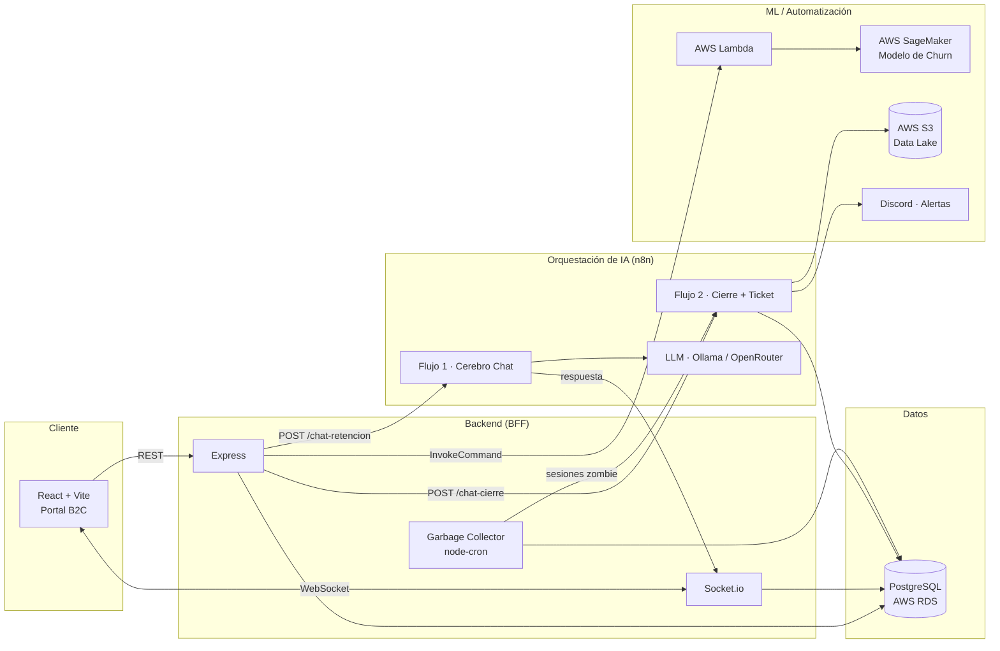

# ConectaMax Telecom — Proyecto Fénix V2

Portal de autogestión B2C para una empresa de telecomunicaciones ficticia, con foco en **retención de clientes**: dashboard con datos reales, sistema de tickets, y un chat de soporte en tiempo real potenciado por un agente de IA que analiza cada conversación para estimar el riesgo de abandono (*churn*) y escalar casos críticos automáticamente.

Proyecto final que integra desarrollo full-stack, arquitectura de eventos en tiempo real, orquestación de IA y Machine Learning en la nube.

---

## Arquitectura



**Flujo de una conversación:**
1. El cliente abre el chat → `POST /api/chat/start` crea/reconecta la sesión, trae el perfil del cliente y dispara una única llamada a SageMaker (vía Lambda) para una probabilidad de churn base.
2. Cada mensaje viaja por WebSocket → se persiste en Postgres → se reenvía a n8n (Flujo 1, agente LangChain con memoria) → el LLM devuelve la respuesta **más** un análisis estructurado (nivel de enojo, tipo de ticket, relevancia del problema, intención de cancelación).
3. Al finalizar el chat (manual o por inactividad, vía cron) → `POST /api/chat/end` dispara n8n (Flujo 2): crea el ticket en la base, sube el log completo a S3, y alerta por Discord si el caso es crítico.

---

## Características principales

- 4 vistas del dashboard con datos reales del cliente logueado (Inicio, Facturación, Mis Servicios, Soporte)
- Chat de soporte en tiempo real, con reconexión automática ante recarga de página
- Agente de IA ("Cerebro") que analiza cada mensaje: nivel de enojo, tipo de ticket, relevancia del problema e intención de cancelación — sin necesidad de un segundo LLM en el cierre
- Integración con un modelo de Machine Learning (AWS SageMaker) para predicción de probabilidad de churn
- Creación automática de tickets de soporte al cerrar la conversación
- Alertas automáticas a Discord para casos críticos (alto enojo o alta probabilidad de churn)
- Limpieza automática de sesiones abandonadas (Garbage Collector cada 30 min)
- Registro de cada interacción en un data lake (S3) como insumo para reentrenar el modelo
- Autenticación JWT, rate limiting, y consultas 100% parametrizadas en toda la API

## Stack tecnológico

| Capa | Tecnologías |
|---|---|
| **Frontend** | React 18, Vite, React Router, Tailwind CSS, Socket.io Client, Lucide Icons |
| **Backend** | Node.js, Express, Socket.io, PostgreSQL (`pg`), JWT, bcrypt, node-cron, Helmet, express-rate-limit |
| **Base de datos** | PostgreSQL (AWS RDS, SSL vía el CA bundle oficial de Amazon) |
| **Orquestación de IA** | n8n (self-hosted), LangChain (Agent + Memory), Ollama (`qwen2.5:7b`) / OpenRouter |
| **Cloud / ML** | AWS SageMaker (modelo de churn), AWS Lambda (puente de inferencia), AWS S3 (data lake) |
| **Otros** | Discord API (alertas) |

---

## Estructura del repositorio

```
.
├── proyecto-completo/
│   ├── backend/          # API REST + WebSocket (Express + Socket.io)
│   │   ├── controllers/  # auth, chat, dashboard
│   │   ├── routes/
│   │   ├── sockets/      # handler de chat en tiempo real
│   │   ├── jobs/         # garbage collector de sesiones
│   │   ├── middleware/   # autenticación JWT
│   │   └── db/           # pool de conexión + migration.sql
│   └── frontend/         # Portal B2C (React + Vite)
│       └── src/
│           ├── pages/        # Landing, Login, Inicio, Facturación, Servicios, Soporte
│           ├── components/   # AppLayout, Sidebar, ChatWidget, etc.
│           └── hooks/
├── dockerProdu/           # Stack completo con Docker Compose (ver sección "Levantarlo con Docker")
├── n8n-workflows/         # Exports de los 2 workflows de n8n (Cerebro Chat, Insert a la nube)
├── .cursor/specs/         # Specs de desarrollo por feature (requirements/design/tasks)
└── .kiro/                 # Documentación histórica del sistema V1
```

---

## Levantarlo con Docker (un solo comando)

La forma más rápida de probar el proyecto: el stack completo (frontend, backend, PostgreSQL con datos de ejemplo, n8n y un LLM local) corre en contenedores. No hace falta instalar Node.js, PostgreSQL ni n8n.

**Requisitos:** Docker Desktop (con Compose v2), ~10 GB libres en disco y al menos 8 GB de RAM asignados a Docker.

```bash
git clone <url-del-repo>
cd <repo>/dockerProdu
cp .env.example .env        # en PowerShell: copy .env.example .env
docker compose up -d --build
```

> Hay que clonar el repo completo: el compose usa carpetas hermanas (`../proyecto-completo`, `../n8n-workflows`).

> **El primer arranque es lento.** Ollama descarga el modelo `qwen2.5:7b` (~4.7 GB) y n8n arranca recién cuando termina. Puede tardar desde unos minutos hasta cerca de una hora según la conexión. Para seguirlo: `docker compose logs -f ollama-pull`.

Una vez arriba:

| Servicio | URL |
|---|---|
| Frontend | http://localhost:5173 |
| Backend (API) | http://localhost:3001 |
| n8n | http://localhost:5678 |
| PostgreSQL | `localhost:5432` (usuario, password y base: los del `.env`) |

Todos los puertos están atados a `127.0.0.1`, es decir, solo son accesibles desde la propia máquina.

**Usuarios de demo** (datos ficticios, definidos en `dockerProdu/db/init/02_seed.sql`): por ejemplo `valentina.diaz@gmail.com`, con contraseña `Demo2026!`. Los 10 usuarios del seed comparten esa misma contraseña.

**Qué se configura solo:** el schema y los datos de ejemplo de PostgreSQL, las credenciales de n8n (Postgres y Ollama) y la publicación de los 2 workflows (`dockerProdu/n8n-init/init.sh`). No hace falta entrar a la UI de n8n.

**Limitaciones del modo demo:**
- No hay conexión a AWS: la predicción de churn vía Lambda/SageMaker no corre (el chat funciona igual, sin la probabilidad base), y los avisos a Discord y el log a S3 del flujo de cierre se omiten sin cortar el flujo. El ticket se crea igual en PostgreSQL.
- La primera vez que se abre la UI de n8n pide crear una cuenta *owner* local. No es necesaria para que funcionen los webhooks.

**Apagar y limpiar:**
```bash
docker compose down        # detiene los contenedores, conserva los datos
docker compose down -v     # además borra los volúmenes (base de datos, n8n y el modelo de Ollama: habría que volver a descargarlo)
```

---

## Cómo correrlo localmente (sin Docker)

### Prerrequisitos
- Node.js 18+
- Una instancia de PostgreSQL con el esquema cargado (ver `proyecto-completo/backend/db/migration.sql` para las migraciones incrementales)
- n8n corriendo localmente (puerto 5678 por defecto) con los 2 workflows de `n8n-workflows/` importados y activados
- Ollama corriendo localmente, o una cuenta de OpenRouter (modelos gratuitos disponibles)
- Credenciales de AWS con permiso `lambda:InvokeFunction` acotado a la función de inferencia del modelo de churn

### Backend
```bash
cd proyecto-completo/backend
npm install
cp .env.example .env   # completar con las credenciales reales
npm run dev
```

### Frontend
```bash
cd proyecto-completo/frontend
npm install
npm run dev
```

El frontend corre en `http://localhost:5173`; el backend en `http://localhost:3001` (proxeado automáticamente por Vite para `/api` y `/socket.io` — ver `vite.config.js`).

---

## Modelo de datos (resumen)

`clientes`, `usuarios`, `cuentas_contrataciones`, `cliente_servicios_pivot` + `servicios_catalogo`, `tipos_contrato`, `metodos_pago`, `crm_contactos`, `sesiones_chat`, `historial_mensajes`, `tickets_soporte`. El detalle completo de columnas y relaciones está en `.cursor/specs/backend-datos-dashboard/design.md` y `.cursor/specs/backend-chat-tiempo-real/design.md`.

## Documentación del proceso de desarrollo

Este proyecto se construyó con un enfoque de *spec-driven development*: cada feature tiene su propio `requirements.md` / `design.md` / `tasks.md` en `.cursor/specs/`, documentando decisiones de arquitectura, criterios de verificación, y — cuando aplica — qué datos son reales y cuáles quedan intencionalmente simulados. `.kiro/` conserva la documentación del sistema original (V1), previo al pivot hacia la arquitectura actual.

## Limitaciones conocidas / Roadmap

- Algunos datos del portal (consumo del ciclo, historial de facturas, número de tarjeta) están **mockeados intencionalmente** — no existen tablas que los respalden en el dataset de origen.
- El modelo de churn actual predice sobre variables estructuradas (perfil del cliente + servicios contratados). Está documentado como roadmap incorporar señales de comportamiento derivadas de tickets (frecuencia de reclamos, nivel de enojo histórico) en una futura versión del modelo, calculadas offline sobre los datos acumulados en S3.
- No existe todavía un evento real de baja de cliente en la aplicación, lo cual limita el reentrenamiento del modelo con etiquetas (*labels*) genuinamente nuevas — hoy el dataset de entrenamiento es una foto fija.

---

## Autor

Proyecto final desarrollado como parte de una formación en Análisis de Sistemas con especialización en AWS / Data Science.
